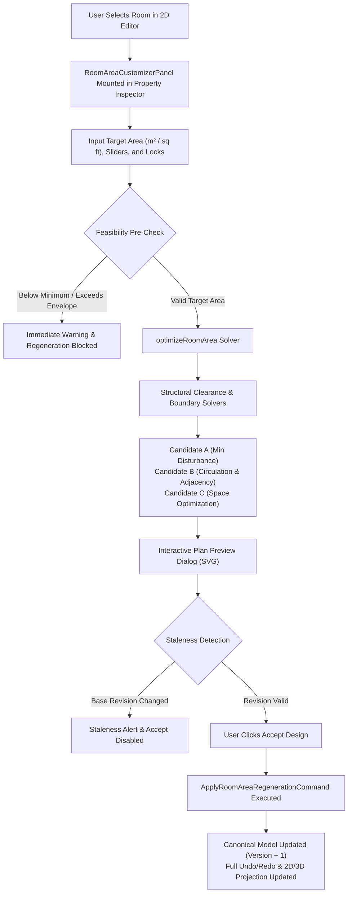

# ARGON 4 — Phase 2: Precise Room Area Customization, Constraint-Aware Regeneration & Architectural Validation

> **Phase Status:** Complete & Verified  
> **Branch:** `feature/phase2-room-area-regeneration`  
> **Repository:** [https://github.com/ruthikb07/AI-FLOOR-PLANNER-SAAS](https://github.com/ruthikb07/AI-FLOOR-PLANNER-SAAS)  
> **Lead Software Architect:** Computational Geometry, Structural Systems & AI Planning Specialist  
> **Functional Reference:** ARCHITEChTURES (room area configuration & AI-assisted geometric optimization)  
> **Governance:** `AGENTS.md` (Sole Authority of Canonical Model, Deterministic Solvers First, Honest Feasibility Reporting)

---

## 1. Executive Summary & Architectural Overview

Phase 2 introduces precise, constraint-aware room area customization to ARGON 4. Users can select any supported room in the 2D CAD editor, specify an exact target area (in $\text{m}^2$ or $\text{sq ft}$), configure structural and neighbor locks, and trigger an intelligent deterministic geometry solver (`optimizeRoomArea`) that generates up to three structurally validated design alternatives without altering the working model until explicitly accepted.

---

## 2. Core Modules & Contracts

### 2.1 Canonical Command Pattern (`@ai-floor-planner/core`)
- **`ApplyRoomAreaRegenerationCommand`** (`packages/core/src/editor/commands/room-area-command.ts`):
  - Strongly typed, reversible command executing under `EditorEngine`.
  - Atomically applies the candidate building state, increments version, updates selection, and provides full `undo()` and `redo()`.
  - Tracks rich metadata: `roomId`, `roomName`, `requestedAreaMm2`, `achievedAreaMm2`, `candidateType`, `changedRoomIds`, and `baseRevision`.

### 2.2 Deterministic Geometric Solver (`@ai-floor-planner/planning-engine`)
- **`optimizeRoomArea`** (`packages/planning-engine/src/refinement/room-area-optimizer.ts`):
  - Pure deterministic solver with zero ungrounded mutations.
  - **Constraint Enforcement:**
    - **Envelope Containment:** Every generated room boundary is strictly verified via `containsPolygon(floor.boundary, room.boundary)`.
    - **Non-Overlapping:** Enforces `polygonIntersectionArea(roomA.boundary, roomB.boundary) <= 2.0 mm²`.
    - **Structural Column Avoidance:** Fixed columns (`S-COLS`) and structural elements (`S-BEAM`) are preserved; partitions clashing with columns are rejected.
    - **Protected Cores:** Staircase and lift cores are fixed vertical circulation elements and cannot be resized as standard rooms (`PROTECTED_CORE_RESIZE_BLOCKED`).
    - **Statutory Minimums:** Enforces statutory minimum areas (e.g. Master Bedroom: $9.5\text{ m}^2$, Living: $18\text{ m}^2$, Kitchen: $5.5\text{ m}^2$) and minimum dimensions (width $\ge 1000\text{ mm}$).
    - **Opening & Door Re-Anchoring:** Shifts hosted doors on adjusted shared partitions to maintain access and circulation continuity.
  - **Area Tolerance:** Enforces strict convergence within $\max(100\,000\text{ mm}^2, \text{targetAreaMm2} \times 0.01)$ (greater of $0.10\text{ m}^2$ or $1.0\%$).
  - **Candidate Generation:** Produces up to 3 distinct alternatives:
    - **Candidate A:** Minimum Disturbance (favors minimal perimeter change and neighbor disruption).
    - **Candidate B:** Circulation & Adjacency (shifts partition to protect corridor connectivity).
    - **Candidate C:** Space Optimization (maximizes usable room shape and daylight access).

### 2.3 User-Facing Studio Customizer (`@ai-floor-planner/frontend`)
- **`RoomAreaCustomizerPanel`** (`packages/frontend/src/components/argon/RoomAreaCustomizerPanel.tsx`):
  - Embedded into `PropertyInspector` when a room is selected.
  - Displays measured internal area in both $\text{m}^2$ and $\text{sq ft}$, clear dimensions ($W \times D$), statutory minimums, and envelope capacity.
  - Interactive unit switcher ($\text{m}^2 \leftrightarrow \text{sq ft}$) and fine-adjustment slider.
  - Generation toggles: "Lock this room", "Lock neighboring rooms", "Preserve structural elements (S-COLS)", "Allow adjacent room repartitioning".
  - Candidate comparison cards with achieved area, difference percentage, impact ledger, and architectural trade-offs.
  - **Interactive Candidate Preview Modal:**
    - High-contrast architectural SVG preview rendering floor boundary, target room (emerald), adjusted neighbors (amber), and fixed structural columns (red).
    - Verification checklist for structural clearance, envelope containment, non-overlap, and statutory minimums.
    - Staleness detection: flags candidate if the underlying project revision changed while previewing, disabling "Accept Design".

---

## 3. Verified 16-Test Regression Suite

All 16 mandatory regression tests were executed and passed in `packages/planning-engine/src/__tests__/room-area-optimizer.test.ts`:

| Test # | Objective | Verification Condition | Status |
| :---: | :--- | :--- | :---: |
| **TEST 1** | Resize bedroom 12 m² to 15 m² | Achieved area within tolerance ($\le 0.10\text{ m}^2$ / $1.0\%$), `toleranceSatisfied === true`. | `PASSED` |
| **TEST 2** | Resize room with adjacent rooms locked | Locked neighbors untouched; outward expansion or honest infeasibility reporting. | `PASSED` |
| **TEST 3** | Allow adjacent unlocked room to adjust | Neighbor shrinks gracefully while strictly maintaining area $\ge \text{statutory minimum}$. | `PASSED` |
| **TEST 4** | Impossible room area (150 m² in 40 m² floor) | Clear infeasibility response; diagnostics contain `BUILDING_ENVELOPE_CAPACITY_EXCEEDED`. | `PASSED` |
| **TEST 5** | Protect structural columns & vertical cores | All columns have identical positions; direct staircase/lift resize blocked (`PROTECTED_CORE_RESIZE_BLOCKED`). | `PASSED` |
| **TEST 6** | Door connectivity & circulation integrity | Repositions hosted openings onto shifted partitions; doors remain inside bounds. | `PASSED` |
| **TEST 7** | Room non-overlapping guarantee | Room intersection areas satisfy `polygonIntersectionArea(r1, r2) <= 2.0 mm²`. | `PASSED` |
| **TEST 8** | Bidirectional unit conversion accuracy | Exact conversions between $\text{m}^2 \leftrightarrow \text{sq ft}$ and $\text{mm} \leftrightarrow \text{ft}$ verified. | `PASSED` |
| **TEST 9** | Alternative generation & trade-offs | Produces distinct Candidates A, B, C with comparative rankings and trade-off summaries. | `PASSED` |
| **TEST 10** | Preview rejection safety | Rejecting/canceling preview leaves working building and version completely untouched. | `PASSED` |
| **TEST 11** | Full command undo & redo | `ApplyRoomAreaRegenerationCommand` executes, undos, and redos restoring exact building state. | `PASSED` |
| **TEST 12** | Save & reload serialization persistence | Serialized JSON building reloads without precision loss; room geometry and vertices intact. | `PASSED` |
| **TEST 13** | 2D and 3D canonical authority alignment | Single-source canonical building contract ensures 2D floor rooms and 3D level walls align. | `PASSED` |
| **TEST 14** | Exported floor measurement consistency | Measured polygon area matches canonical room area property within $1\text{ mm}^2$. | `PASSED` |
| **TEST 15** | Non-rectangular geometry honesty | Unsupported non-rectangular room geometry honestly reported (`NON_RECTANGULAR_GEOMETRY_UNSUPPORTED`). | `PASSED` |
| **TEST 16** | Stale preview detection | Prevents outdated candidate previews from overwriting newer project revisions. | `PASSED` |

### Additional Verified Test Suites
- **Frontend Component Tests:** `packages/frontend/src/__tests__/room-area-customizer.test.tsx` (5 tests passed: unit toggle, inputs, locks, regeneration, command dispatch).
- **3D Projection Tests:** `packages/projection-3d/src/__tests__/room-area-projection.test.ts` (verified `Building3DProjector().project` reflects regenerated geometry).

---

## 4. Quality Gate Verification Results

The monorepo quality gates were executed and passed with zero errors:

| Quality Gate | Command | Result | Details |
| :--- | :--- | :---: | :--- |
| **Unit Tests** | `pnpm test:unit` | `PASSED` | **17/17 tasks successful across all 9 packages** |
| **Typecheck** | `pnpm typecheck` | `PASSED` | **16/16 tasks successful with 0 errors** |
| **Linter** | `pnpm lint` | `PASSED` | **16/16 tasks successful with 0 warnings/errors** |
| **Production Build** | `pnpm build` | `PASSED` | **9/9 packages built successfully for production** |
