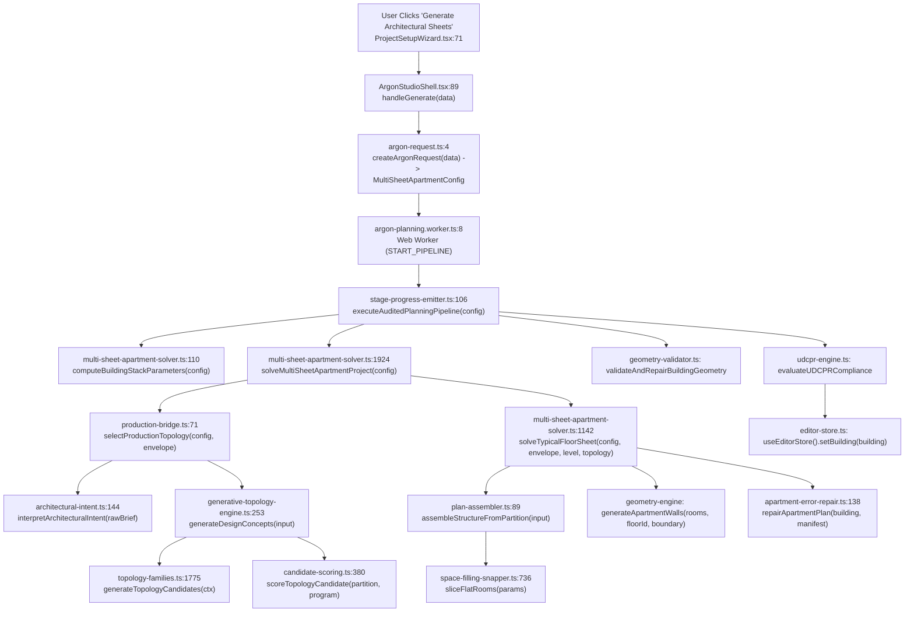

# RH PLANNER — GENERATION PIPELINE MAP

**Date:** 2026-11-13  
**Purpose:** Complete end-to-end execution map of the active architectural generation pipeline vs. disconnected/bypassed pipelines in the repository.

---

## 1. End-to-End Active Generation Execution Trace

### Step-by-Step Code Path

| Step | File & Line | Function / Method | Input | Output | Defect / Observation |
|---|---|---|---|---|---|
| 1 | `packages/frontend/src/components/argon/ProjectSetupWizard.tsx:71` | `handleComplete()` | `ProjectSetupWizardData` | Calls `onGenerate(wizardData)` | `flatsPerFloor` UI allows 1–8, prompt text in `aiPrompt`, optional `referenceImage`. |
| 2 | `packages/frontend/src/services/argon-request.ts:4` | `createArgonRequest(data)` | `ProjectSetupWizardData` | `MultiSheetApartmentConfig` | **Bug:** Clamps `flatsPerFloor` to `[2, 3, 4]` (line 5), dropping 1, 5, 6. Never sets `generationSeed`. |
| 3 | `packages/frontend/src/services/argon-planning.worker.ts:8` | `self.onmessage` | `{ type: 'START_PIPELINE', config }` | `PipelineExecutionResult` | Runs 100% in browser Web Worker; **never contacts backend or Gemini**. |
| 4 | `packages/planning-engine/src/pipeline/stage-progress-emitter.ts:106` | `executeAuditedPlanningPipeline(config)` | `MultiSheetApartmentConfig` | `{ projectResult, auditResult, udcprReport }` | Emits 7 deterministic stage progress events. |
| 5 | `packages/planning-engine/src/apartment/multi-sheet-apartment-solver.ts:1924` | `solveMultiSheetApartmentProject(config)` | `MultiSheetApartmentConfig` | `MultiSheetApartmentResult` | Computes buildable `envelope` from `plotWidthMm`, `plotDepthMm`, `setbacksMm`. |
| 6 | `packages/planning-engine/src/topology/production-bridge.ts:71` | `selectProductionTopology(config, envelope)` | `MultiSheetApartmentConfig`, `Box2D` | `SelectedTopology \| undefined` | **Bug:** Discards `config.units[i].targetCarpetSqFt`; passes only `unitTypes` strings and `config.aiPrompt`. |
| 7 | `packages/planning-engine/src/topology/architectural-intent.ts:144` | `interpretArchitecturalIntent(rawBrief)` | `RawArchitecturalBrief` | `ArchitecturalProgram` | **Bugs:** `"Provide a central lift core"` fails verb regex (`line 203`); `"no OTS"` throws `IntentConflictError` (`line 218`). |
| 8 | `packages/planning-engine/src/topology/topology-families.ts:1775` | `generateTopologyCandidates(ctx)` | `TopologyContext` | `TopologyGenerationResult` | **Bugs:** Disables `planFootprint` (`line 1797`), ignores `targetCarpetSqFt` in `flatFootprintTarget` (`line 764`), converts unused envelope into giant `OPEN_TO_SKY_VOID` rooms. |
| 9 | `packages/planning-engine/src/topology/plan-assembler.ts:89` | `assembleStructureFromPartition(input)` | `AssembleInput` | `AssembledPlan` | Transposes each flat via `frameFor` (`rect-frame.ts`) and calls `sliceFlatRooms`. Relabels dropped sit-outs as interior `'Family Sit-out'`. |
| 10 | `packages/planning-engine/src/interpretation/space-filling-snapper.ts:736` | `sliceFlatRooms(params)` | `SliceFlatParams` | `SliceFlatResult` | **Bug:** Service depth (`kitchenRoom`) can extend past `passage`, leaving `< 1100 mm` shared wall between `livingRoom` and `passage`, severing private wing access. |
| 11 | `packages/planning-engine/src/repair/apartment-error-repair.ts:138` | `repairApartmentPlan(building, manifest)` | `Building`, `DynamicApartmentManifest` | `{ building, repairReport }` | **Bug:** When `passage` is disconnected from `livingRoom`, Pass 4 (`repairPrivacyAndCirculation`, line 1049) connects `master_bed` directly to `kitchenRoom`! |

---

## 2. Disconnected, Duplicated & Bypassed Pipelines

Our audit identified **four separate layout/planning pipelines** across the monorepo, three of which are either bypassed by the active UI or completely disconnected:

### Pipeline 1 (ACTIVE): `planning-engine` Multi-Sheet + Generative Topology Engine
- **Entry:** `solveMultiSheetApartmentProject` -> `selectProductionTopology` -> `generateDesignConcepts` -> `assembleStructureFromPartition` -> `sliceFlatRooms`.
- **Status:** Active in `ArgonStudioShell` / `argon-planning.worker.ts`.

### Pipeline 2 (FALLBACK ONLY): `planning-engine` Legacy Macro Partition (`partitionMacroFootprint`)
- **Entry:** `solveOrthogonalSpaceFillingApartment` (`packages/planning-engine/src/interpretation/space-filling-snapper.ts:624`) -> `partitionMacroFootprint` (`line 368`).
- **Status:** Used only when `selectProductionTopology` returns `undefined` (e.g., when `interpretArchitecturalIntent` throws `IntentConflictError` on `"no OTS"`, or when all 7 topology families reject the envelope).
- **Behavior:** Hardcodes a single central vertical core band with fixed west/east flat quadrants.

### Pipeline 3 (DISCONNECTED): `ai-orchestration` Deterministic Apartment Layout Planner
- **Location:** `packages/ai-orchestration/src/apartment/layout-planner.ts` (`planApartmentLayout`), `area-budget.ts` (`validateFloorFeasibility`), `manifest.ts` (`buildApartmentGenerationManifest`), `core-optimizer.ts`, `envelope-solver.ts`.
- **Status:** **100% disconnected from `planning-engine` and `frontend`.**
- **Observation:** This module implements a clean 3-band apartment layout planner (`service`, `passage`, `facade`) with 4 strategies (`balanced`, `daylight`, `privacy`, `circulation`) and explicit `targetCarpetAreaSqFt` area budgeting (`area-budget.ts`), but it is only called by unit tests inside `packages/ai-orchestration/src/__tests__/`!

### Pipeline 4 (DISCONNECTED): `planning-engine` Single-Family / Multi-Floor Graph & Candidate Generator
- **Location:** `packages/planning-engine/src/generation/reviewed-workflow.ts` (`runReviewedGenerationWorkflow`), `generator/candidate-generator.ts` (`CandidateGenerator`), `generator/architectural-layout-engine.ts` (`ArchitecturalLayoutEngine`).
- **Status:** Legacy single-residence / villa workflow; bypassed by `ArgonStudioShell` which always runs `executeAuditedPlanningPipeline`.

### AI Provider Layer (DISCONNECTED FROM GENERATION): `ai-orchestration` `GeminiProvider`
- **Location:** `packages/ai-orchestration/src/providers/gemini.ts`, `orchestration/service.ts` (`AIOrchestrationService`), `orchestration/architectural-evaluation.ts`.
- **Status:**
  - `AIOrchestrationService.parseRequirements` is never called by `frontend` or `backend`.
  - `evaluatePlanArchitecturally` is mounted on `POST /api/evaluate/architecture` in `packages/backend/src/server.ts`, but the frontend never calls it during or after generation.

