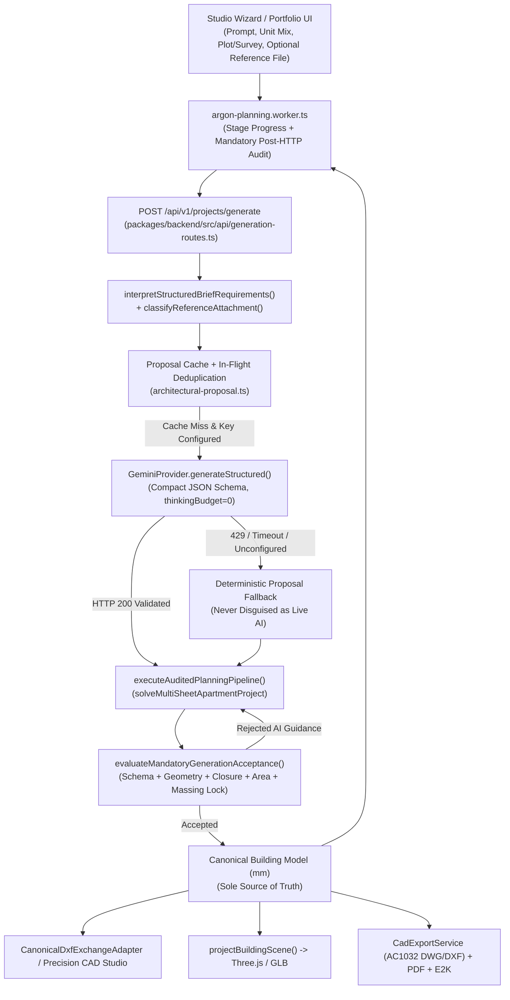

# RH Planner — AI Pipeline Architecture & Implementation Matrix

> **Verification Scope:** Internal software engineering audit on branch `feat/phase4a-ai-audit-and-cota-cad` (base `75716ddcfb52142314ed8d2edd343607a15c67da`). Automated tests verify software behavior only — `INTERNAL ENGINEERING GATE PASSED` · `PROFESSIONAL REVIEW REQUIRED`.

## 1. End-to-End Hybrid AI + Deterministic Generation Pipeline

## 2. Role Boundaries (AI vs Deterministic Engines)

1. **AI Orchestration (`@ai-floor-planner/ai-orchestration`):**
   - Converts natural-language architectural prompts and optional raster reference sketches (`image/png`, `image/jpeg`, `image/webp`) into bounded `ArchitecturalDesignProposal` JSON.
   - Classifies requirements into `MANDATORY`, `USER_PREFERENCE`, `AI_SUGGESTION`, `DEFAULT`, `INFERRED_CONSTRAINT`, and `JURISDICTION_VERIFICATION_REQUIRED`, and surfaces `BriefRequirementConflict` records (`CONFLICTING_UNIT_COUNT`, `CONFLICTING_OTS_DIRECTIVE`, `CONFLICTING_LOCKED_MASSING`, `CONFLICTING_BALCONY_DIRECTIVE`, `REFERENCE_OVERRIDDEN_BY_BRIEF`).
   - Never emits raw coordinates directly into canonical walls/rooms and never overrides explicit user unit counts, locked massing shapes, or surveyed site boundaries.
2. **Deterministic Solvers & Acceptance Gate (`planning-engine`, `geometry-engine`, `constraint-engine`):**
   - Author all millimetre room polygons, wall centrelines/thicknesses (`230 / 150 / 115 / 100 mm`), hosted doors/windows, stairs, lifts, OTS ducts, and setbacks.
   - Enforce raw planar area conservation (`|Gross - Sum(Components)| < 0.001 mm²`), apartment closure, opening fit, and strict carpet targets before any candidate is returned to the client.

## 3. Codebase AI Module Status Matrix

| Module / Path | Status | Verification Evidence |
| --- | --- | --- |
| `ai-orchestration/src/providers/gemini.ts` (`GeminiProvider`) | **ACTIVE IN PRODUCTION** | Live & deterministic tests in `phase4a-ai-pipeline-verification.test.ts` |
| `ai-orchestration/src/orchestration/architectural-proposal.ts` | **ACTIVE IN PRODUCTION** | Drives `/api/v1/projects/generate` with compact text vs vision schema, caching, conflict detection & attachment disposition |
| `backend/src/api/generation-routes.ts` (`handleProjectGeneration`) | **ACTIVE IN PRODUCTION** | Single-proposal hybrid generation + deterministic variant fallback when AI guidance fails mandatory gate |
| `backend/src/api/cad-edit-routes.ts` (`handleCadEditProposal`) | **ACTIVE IN PRODUCTION** | Bounded 220-token structured CAD edit intent extraction feeding `proposeControlledCadEdit` |
| `backend/src/api/evaluation-routes.ts` (`handleArchitecturalEvaluation`) | **ACTIVE IN PRODUCTION** | Deterministic design evaluation + optional advisory commentary |
| `ai-orchestration/src/providers/openai.ts` (`OpenAIProvider`) | **IMPLEMENTED, NOT WIRED IN RUNTIME** | Reported honestly by `/api/v1/health` `providers[]`; unit-tested only (`gpt-4o-mini`, no multimodal vision) |
| `ai-orchestration/src/editing/planner.ts` (`AIEditPlanner`) | **LEGACY / SUPERSEDED** | Legacy single-house box model; superseded for canonical apartments by `planning-engine/src/refinement/cad-ai-edit-proposal.ts` |
| `ai-orchestration/src/research/architectural-research-agent.ts` | **ISOLATED OPT-IN UTILITY** | Unit-tested standalone research helper; not invoked by production generation routes |
| `ai-orchestration/src/apartment/*` | **LEGACY SCHEMATIC** | Superseded by `planning-engine/src/apartment/multi-sheet-apartment-solver.ts` |
