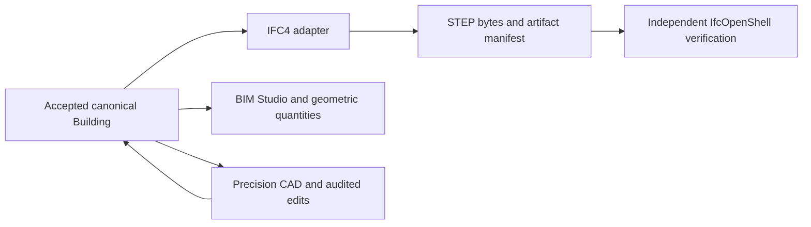

# OpenBIM architecture

The canonical Building and editor revision remain authoritative. The IFC exchange snapshot binds the project ID, building ID, revision and canonical digest. An IFC manifest separately binds the exact STEP artifact bytes, semantic IDs, opening hosts, coordinate frame and declared omissions.

RH Planner uses the existing Building-local right-handed frame and millimetres. Successful software-format checks and independent readback are distinct from native application reopen and professional review. External IFC belongs in a read-only model boundary, separate from architectural edits and analyzed structural design.
