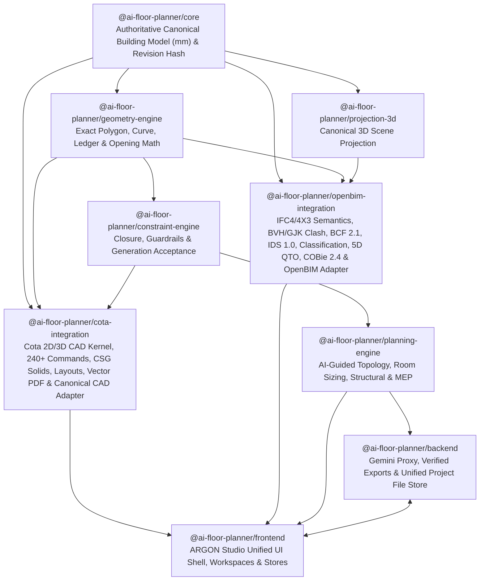

# Three-Systems Unified Architecture (`AI Floor Planner` + `OpenBIM Studio` + `Cota CAD`)

## 1. Executive Summary

This document defines the unified single-application, single-repository, single-canonical-model architecture integrating:

1. **Primary Host Application — RH Planner (`AI-FLOOR-PLANNER-SAAS`):** Authoritative architectural planning solver, `Building` canonical model (`mm`), computational geometry engine (`0.000 mm²` planar conservation), Maharashtra UDCPR 2020 & NBC 2016 compliance engine, 2D architectural editor, 3D building/isometric projection (`projection-3d`), structural framing & ETABS bridge, and durable project/revision persistence.
2. **Integrated BIM Engine — `@ai-floor-planner/openbim-integration` (from `openBIMstudio` v0.74.0):** BIM authoring & property classification, IFC4 and IFC4X3 semantic inspection & per-entity fidelity reporting, 3D BVH + GJK hard/clearance/duplicate clash coordination, BCF 2.1 issue management & `.bcfzip` exchange, buildingSMART IDS 1.0 audit engine, AST-compiled formula schedules & 5D QTO roll-ups (Uniclass 2015 / OmniClass 21 / UniFormat II), and COBie 2.4 facility handover datasets.
3. **Integrated Professional CAD Engine — `@ai-floor-planner/cota-integration` (from `cota` v2.49.3):** Full 2D & 3D parametric `DocumentModel`, classic interactive `CommandEngine` with 240+ CAD commands & aliases, screen-space OSNAP + OTRACK + Polar + UCS coordinate systems, parametric 3D CSG solid modeling (`three-bvh-csg` mesh kernel), associative ISO/ANSI dimensions & multileaders, hatches & blocks with attributes, paper-space layouts with scaled viewports & projected views (`VIEWBASE`/`VIEWPROJ`), dependency-free vector PDF plotting, and multi-format CAD exchange (`.cota`, `.dwg`, `.dxf`, `.obj`, `.stl`, `.step`, `.iges`, `.pdf`).

All three engines execute inside **one React 18 + Vite 5 + Three.js 0.185 + pnpm/Turborepo SaaS host**, **one `ArgonStudioShell` navigation shell**, **one `EditorEngine` canonical state**, and **one unified project envelope & backend storage service**. No iframes, separate servers, secondary React roots, or competing building databases are introduced.

---

## 2. Monorepo Package Topology

---

## 3. Single Canonical Building Model & Coordinate Frame Contracts

`@ai-floor-planner/core`'s `Building` (`version`, `canonicalBuildingHash`) is the **sole authoritative source of architectural geometry**.

### 3.1 Coordinate Transformations (Applied Exactly Once at Adapter Boundaries)

| Domain | Axes & Handedness | Units | Forward Transform from Canonical `(x, y, z)` | Inverse Transform to Canonical |
| --- | --- | --- | --- | --- |
| **Canonical Building (`@ai-floor-planner/core`)** | `X` right (east), `Y` down (south), `Z` up (elevation) | `mm` | Identity `(x, y, z)` | Identity `(x, y, z)` |
| **OpenBIM World (`@ai-floor-planner/openbim-integration`)** | `X` east, `Y` up, `Z` north (right-handed Y-up) | `m` | `X = x / 1000`, `Y = z / 1000`, `Z = -y / 1000` | `x = X * 1000`, `y = -Z * 1000`, `z = Y * 1000` |
| **Cota CAD World (`@ai-floor-planner/cota-integration`)** | `X` east, `Y` north (`+Y` up on plan), `Z` elevation (right-handed Z-up) | `mm` | `X = x`, `Y = -y`, `Z = z` | `x = X`, `y = -Y`, `z = Z` |

### 3.2 Controlled Writeback Synchronization Protocol

1. **Source & Entity Identification:** Every canonical element projected into Cota CAD (`A-WALL`, `A-DOOR`, `A-GLAZ`, `A-ROOM`, `A-SLAB`, `S-COLS`, `S-BEAM`, `S-GRID`, `A-DIMS`) or OpenBIM carries immutable provenance (`canonicalId`, `canonicalKind`, `floorId`, `hostWallId`, `sourceRevision`, `sourceSha256`).
2. **Drafting vs. Architectural Separation:** Auxiliary CAD lines, construction rays, 3D mechanical solids, hatches, blocks, and paper-space viewports reside in Cota drawing layers (`0`, `C-DRAFT`, `C-SOLID`, `C-HATCH`, `C-DIM`, `C-ANNO`) persisted as project-attached `.cota` drawing documents. CAD lines are **never** automatically converted into architectural walls.
3. **Explicit Validated Promotion / Edit:** When a user edits a mapped architectural entity or explicitly promotes a CAD/BIM proposal:
   - Adapter checks `expectedRevision === currentBuilding.version` and `expectedSha256 === canonicalBuildingHash(currentBuilding)` (rejecting stale writes).
   - Candidate canonical `Building` is synthesized and audited through `validateBuildingSchema`, `validateApartmentClosure`, `fitFloorOpeningsInsideWalls`, and `generationBlockingFindings`.
   - User inspects the geometric diff preview; upon acceptance, `EditorEngine.execute(new ReplaceBuildingCommand(validatedBuilding))` increments `building.version`, refreshes 2D/3D/BIM/CAD views, recalculates schedules/quantities, and invalidates stale export manifests.

---

## 4. Mountable Integration APIs & Lifecycle Management

Both integrated engines expose framework-agnostic mount controllers consumed by thin React workspace wrappers (`CotaWorkspace.tsx`, `BimStudio.tsx`, `ModelCoordinationWorkspace.tsx`):

- **`mountCotaCad(options)` (`@ai-floor-planner/cota-integration`):**
  - Instantiates an isolated Cota `DocumentModel`, `LayerService`, `CommandEngine` (all 240+ commands), and 1–4 Three.js `Viewport` instances inside the supplied DOM `container`.
  - Attaches `ResizeObserver`, scoped keyboard/pointer handlers, command-line/autocomplete subscriptions, and canonical `Building` projection sync.
  - `unmount()` cancels pending prompts, terminates any CAD import workers, disconnects `ResizeObserver`, and disposes all Three.js `WebGLRenderer`, geometries, materials, and textures.
- **`mountOpenBimStudio(options)` (`@ai-floor-planner/openbim-integration`):**
  - Instantiates an isolated `OpenBimSessionController` bound to `(projectId, buildingId, revision)` managing IFC4/IFC4X3 semantic models, federated reference alignments, BVH/GJK clash runs, BCF 2.1 topics, IDS 1.0 audit reports, element classifications, 5D QTO rules, and COBie 2.4 tables.
  - `unmount()` aborts in-flight worker tasks, clears listeners, and releases transient BVH acceleration structures.
