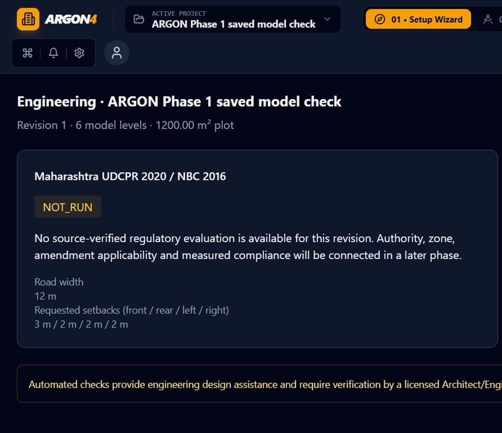

# ARGON 4 Phase 1 implementation and verification

Completed 8 November 2026 (Asia/Calcutta). Status: INTERNAL ENGINEERING GATE PASSED. Professional review remains required. Phase 2 has not started.

## Result

All 39 baseline failing test cases are recovered. The wizard now constructs a fresh canonical millimetre request and runs the real multi-sheet solver in a worker, rather than auditing the previous editor state. The generated model passes geometry/closure checks, saves, and reopens. Area validation measures the disjoint canonical ledger and reports gaps/overlaps independently. ARGON's engineering and export workspaces show explicit unavailable/not-run states. Tailwind is installed and integrated with PostCSS and the existing Vite application.

## Changes by workstream

### Geometry, layout and baseline recovery

- `constraint-engine/src/apartment-closure.ts`: removed the in-place ownership/tag/space-use sanitizer; validation works on frozen input. Party-wall minimum is 230 mm. Raw area closure requires abs(delta) < 0.001 mm²; unsupported cells, overlaps and unassigned space are independent failures. Exact bedroom counts are checked against the correct manifest unit. Undefined unit indices no longer accidentally match the first unit specification.
- `geometry-engine/src/apartment-ledger.ts`: preserves clipped wall-union accounting while using exact cell-interior ownership instead of the editor hit-test's 1 mm tolerance. Reports unsupported nonorthogonal geometry and room/void overlap separately. `apartment-walls.ts` exposes the 0.001 mm² tolerance and generates floor-scoped wall IDs.
- `planning-engine/src/validator/geometry-validator.ts`: removed forced-zero delta assignment and rounded acceptance; area checks use mm² tolerances. A second detection pass confirms repairs before marking issues corrected. Read-only passes retain the original model and do not generate beam IDs. Exterior door validation requires a connected physical outdoor polygon, not a nearby room name. Unresolved opening collisions remain errors. Column deduplication retains wall anchors rather than averaging locations into rooms; remaining duplicates block validity. Stair comparisons match the corresponding core rather than aligning every stair to the first staircase.
- `space-filling-snapper.ts`: Living & Dining adjoins the corridor and bedroom side; kitchens no longer form a full-depth separating strip. Main entries use the physical shared wall and fit 1050 mm where possible or 1000 mm on the constrained half-corridor frontage. Bedroom openings cannot fall back to 700 mm service-door widths. Common and attached bathroom ownership now matches physical access. Bedroom/bathroom counts remain exact for 1BHK–4BHK layouts; utility and balcony polygons remain distinct.
- `repair/apartment-error-repair.ts`: reachability updates the whole newly connected component, preventing extra doors into attached bathrooms. It cannot route an attached bathroom through a different room. Partition shifts are limited to compatible full shared edges, avoiding new gaps. Missing bathrooms can be restored in measured vacant unit polygons. Stale rectangular metadata is reconciled with canonical rectangular boundaries.
- `auto-furnish-apartment.ts`: explicitly excludes utility/balcony rooms from kitchen furnishing and searches usable shorter counter runs without bypassing door clearance checks.
- `interpretation/apartment-plan.ts`: all image/schematic sources use measured floor outlines and explicit void rings; a rectangular image frame is not treated as built floor area. Invalid topology becomes a rejection diagnostic. Manifest closure errors are included in rejection details. Legitimate bedroom doors to attached balconies are no longer rejected by a blanket prohibition.

### Real generation and model persistence

- Core `MultiSheetApartmentConfig` carries project identity/name, requested setbacks, prompt and reference payload. The canonical model retains design-intent metadata and per-unit area targets.
- `frontend/services/argon-request.ts` converts wizard metres to mm once; maps road direction, floor/stilt choices, exact unit mix and carpet targets; preserves prompt/reference input; and assigns a fresh project ID.
- The upload control reads PNG/JPG/PDF data with type/size checks and reports errors. The UI explicitly states that prompt/reference are retained as intent; this deterministic phase does not interpret reference geometry or execute AI design instructions. Target carpet areas remain targets, not a promise of exact achieved areas.
- `pipeline/stage-progress-emitter.ts` executes actual solver stages, records statuses/timings, progresses monotonically from 0 to 100, and emits FAILED diagnostics rather than COMPLETE when generation is invalid. The regulatory stage checks availability and reports NOT_RUN; it does not call the legacy estimator and present assumptions as compliance.
- `argon-planning.worker.ts` keeps computation off the UI thread. Cancellation terminates the worker; stale worker messages cannot apply a result. Retry uses the submitted brief. Failures stay visible.
- `multi-sheet-apartment-solver.ts` respects requested setbacks and road inputs, omits stilt when ground residential is selected, and starts ground residential at level 0. Drawing-only column schedules are not extra physical floors; refuge representations replace their physical residential level. Global entity IDs and their wall/room/opening/column/furniture references are floor-scoped, fixing save/reopen deserialization failures.
- The CAD workspace lists actual model floors and calls the editor floor switch. Its audit panel shows measured revision-specific results. Canonical-only canvas mode hides the legacy fixed schedule, unrelated image underlay and hardcoded conservation footer.

### Honest statuses and styling

- `UdcprEtabsAnalysis.tsx` uses the active project's name, revision, plot area, road width and requested setbacks; regulatory evaluation is NOT_RUN and ETABS is UNAVAILABLE. There are no assumed safety results, soil values or compliance certificates.
- `ExportCenterWorkspace.tsx` derives its floor rows from the current model. It marks the unconnected artifact registry NOT_RUN and disables unavailable previews/downloads. It does not claim files were generated or verified.
- Frontend Tailwind 3.4.17/PostCSS/autoprefixer configuration, content paths and CSS directives now compile the ARGON utility classes. Scoped dark select/option styles, flex sizing, wrapping/scrolling header navigation and scrollable wizard content prevent the previously unstyled controls and header collisions.
- Integration follows the official [Tailwind Vite setup](https://v3.tailwindcss.com/docs/guides/vite).

## Verification evidence

| Command | Final result |
|---|---|
| `pnpm --filter @ai-floor-planner/planning-engine test` | Exit 0; 44 test files, 319 tests passed |
| `pnpm typecheck` | Exit 0; 16/16 tasks successful |
| `pnpm build` | Exit 0; 9/9 tasks successful; frontend assets and planning worker generated |
| `pnpm lint` | Exit 0; 16/16 tasks successful |
| `pnpm test` | Exit 0; 18/18 tasks successful; 1,429 passed, 12 skipped, zero failures |

Turbo reused unchanged task results; the final monorepo test run had 10 cached tasks. The explicit planning-engine test command ran separately after the complete gate. The build emits the existing large-chunk advisory for the 3D bundle; it is a warning, not a failed build. Skipped live-provider/acceptance tests remain skipped and are not represented as passed.

| Package | Passed | Skipped |
|---|---:|---:|
| core | 192 | 0 |
| geometry-engine | 82 | 0 |
| constraint-engine | 185 | 0 |
| renderer | 88 | 0 |
| projection-3d | 22 | 0 |
| planning-engine | 319 | 0 |
| ai-orchestration | 242 | 2 |
| frontend | 142 | 0 |
| backend | 157 | 10 |

New regressions cover frozen-input purity, 229 mm party walls, wall-union deduplication, a narrow uncovered gap, sub-mm² overlaps, unsuccessful repairs, actual two-/three-/four-unit generation, mixed 1BHK–4BHK counts, stilt/ground behavior, wizard mapping/reference retention, progress/failure semantics, honest status rendering and serialization round trips. Existing tests were not skipped or relaxed to hide failures. Two earlier false expectations were replaced with stronger assertions: incomplete geometry must be invalid, and a column drawing must not be counted as a physical storey. Existing assertions gained failure diagnostics where useful.

Browser verification on localhost confirmed wizard generation, real stage updates, opening the first residential floor, measured zero area delta with no outstanding geometry errors on the verification project, honest engineering/export statuses and disabled unavailable controls. A full browser reload reopened the newly saved project successfully after the ID fix. Layout was checked at 1440×900 and narrow widths; at 390 px the measured header ends where main content begins and document width remains 390 px. Temporary viewport overrides were reset. This is UI/workflow verification, not architectural drawing or regulatory acceptance.

Final command output is saved alongside this report in `phase1-planning.log` and `phase1-final-{typecheck,build,lint,test}.log`. `changed-source-files.json` records actual source changes versus the Phase 1 starting snapshot, distinguishing this work from the user's pre-existing modifications.

## Boundaries and remaining phases

The real regulatory rules/authority/amendment engine, licensed ETABS analysis, production artifact registry and independent export wiring remain later-phase work. Existing CAD/PDF exporters remain present, but the new export workspace deliberately does not advertise them as verified artifacts. Full isometric/customizer wiring and photorealistic Blender execution are not claimed by Phase 1. Dense drawing annotations still need dedicated visual/export acceptance; passing geometry checks does not establish drafting quality or structural adequacy.

The requested package tests/builds regenerate existing CAD/PDF fixtures, backend bundles and caches. Those side effects and pre-existing user changes were retained; no broad cleanup, reset or commit was performed. A pre-existing trailing blank line in `studio.css` remains outside this phase's edits.

Automated checks provide engineering design assistance and require verification by a licensed Architect/Engineer before municipal submission.
