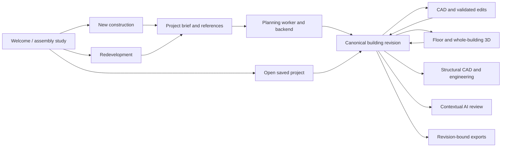

# RH Planner cinematic redesign

## Video analysis and motion map

All three local WhatsApp clips were sampled with FFmpeg at two frames per second. The contact sheets are under `test-artifacts/cinematic-redesign`.

| Reference | Observed sequence | RH Planner implementation |
| --- | --- | --- |
| 11.57.13 PM · 10.15 s | 0–1.5 s exterior, 1.5–4 s approach and lobby, 4.5–8 s façade and occupied levels, 8–10 s rooftop and exterior pullback | The same Three.js scene moves from a high site view to a closer low framing, then rises and pulls back to reveal the roof and landscape. Architectural subjects and stage names stay in the frame through the sequence. |
| 11.57.17 PM (1) · 13.72 s | 0–2 s ground and frame preparation, 2–7.5 s vertical framework and slabs, 7.5–13.7 s pale editorial layouts interleaved with imagery | A sticky model sits beside an ivory project column. The native scroll coordinate drives the grid, plan lines, structural frame, slabs, enclosure and landscape in sequence. Backwards scrolling reuses the same mapping. An editorial handoff leads into project setup. |
| 11.57.17 PM · 52.20 s | 0–2 s aerial orbit, 2.5–9 s roof cutaway and contextual level information, 9.5–12 s street elevation, 12.5–52 s model-to-presentation tutorial | The project workspace uses the existing canonical projection for view and floor selection. It exposes contextual level and room labels and reuses entity IDs across views. The tutorial informed the continuity of model views. |

The welcome study is original illustrative geometry. Project CAD, 3D and structural framing derive from the active model. The welcome model includes a survey grid, illustrative plan lines, lift core, slabs, envelope, glazing, balconies and landscaping. It approximates the camera and editorial pacing of the clips. Photoreal lobby footage and the exact reference transitions are outside this implementation.

## Connected journey

## Design and interaction

- The app uses ivory `#F6F2EA`, parchment `#ECE5DA`, champagne `#B08B5B`, bronze accents and graphite `#171B1D`. Text and focus states use higher-contrast variants. Cormorant Garamond is used for display, with readable UI text and monospace metadata.
- `rh-cinematic.css` defines project actions, the welcome composition, shared workspace focus and navigation, the assistant, and export cards. Setup and workspace controls use the existing Argon component tokens. Technical drawing canvases retain their discipline-specific palettes.
- Welcome stage buttons, native scrolling and reduced motion all read the same progress value. GSAP eases camera updates in normal motion. Rendering is event-driven and caps the pixel ratio. The welcome scene disposes its resources on unmount and falls back to an architectural grid when WebGL is unavailable.
- Generation uses the installed production worker and API. The server request is indeterminate while no progress events exist. Local fallback displays real worker events. The elapsed timer only measures time. Native modeling, geometry review, saving and export are separate operations.
- PDFs display through the browser PDF viewer after a signature check. Local metadata estimates page count and reads the MediaBox when available. Confirmed values remain manual evidence. Page bytes live in the session and must be reattached after reload.
- The assistant uses the existing architectural evaluation API with the building revision, selected floor, relevant flat and entity IDs, room dimensions and validation context. Requests are cancelled when the context changes. The service is advisory. The plan editor is the explicit path for geometry changes.
- Verified CAD/PDF exports use the existing artifact registry and client checksum checks. Standalone GLB export validates the header, version and length. Blender package files require verified descriptors and are checked before download. Native EDB remains gated by the existing reviewed StructuralProject and token workflow. Structural CAD presents the model’s framing and exposes native result availability without fixed load, soil, drift, reinforcement or adequacy values.

## Feature status

| Feature | Status | Evidence or dependency |
| --- | --- | --- |
| RH branding, palette, workspace navigation and recovery UI | IMPLEMENTED | Active welcome, setup, CAD, room editing, 3D, engineering and export interfaces. |
| Cinematic welcome, site-to-building construction, reversible scroll, skip and CTAs | IMPLEMENTED | Original Three.js study with one mounted canvas, native scroll and keyboard stage controls. The model uses illustrative materials and lighting. |
| Detailed lobby and stair reveal, photoreal materials and reflections | PARTIALLY IMPLEMENTED | Lobby and core massing, simulated daylight, façade transparency and roof reveal. Detailed interior shot and photoreal render pass remain open. |
| New construction and redevelopment | PARTIALLY IMPLEMENTED | Distinct entry points, program and owner inputs, duplex/triplex levels and existing feasibility review. Level allocation uses a schematic stack. A native 3D allocation editor and structural validation of retained components remain open. |
| Requirements and reference intake | IMPLEMENTED | Residential program, plot, road, setbacks, floor and unit mix, prompt, image/DXF metadata, PDF preview and confirmation. |
| PDF-to-model reconstruction | NOT IMPLEMENTED | A reconstruction service would need to return page identity, drawing type, vector/raster evidence, candidate geometry with provenance and confidence, and a calibrated transform. Confirmed entities must then enter a canonical model import command and pass topology and constraint validation before projection. |
| Architectural alternatives | PARTIALLY IMPLEMENTED | Existing seeded and massing-specific regeneration and real layout assessment are connected. Simultaneous side-by-side comparison and review of multiple retained candidates remain open. |
| Project-aware AI | PARTIALLY IMPLEMENTED | Brief intake and an advisory evaluation panel are connected. Free-form edits, AI-applied revisions, multi-candidate comparison and streamed backend stage events remain open. A future edit API must return typed commands keyed by entity IDs and base revision, with a validation result and explicit confirmation before application. |
| CAD and 3D inspection | IMPLEMENTED | Shared model and floor selection, 2D editing, isolated and exploded 3D views, camera presets, visibility, room selection and drawing tools. Arbitrary section plane editing is outside the implemented controls. |
| Structural CAD and engineering | PARTIALLY IMPLEMENTED | Canonical columns, beams and outline, regulatory evidence and export controls. Native analysis results are unavailable on the tested architectural revision. |
| PDF, DWG, DXF, GLB, Blender, preliminary ETABS and engineering downloads | PARTIALLY IMPLEMENTED | Independent actions use real routes. Native Blender, reviewed EDB and engineering report availability depend on environment, source inputs and verification evidence. |
| Accessibility and performance | PARTIALLY IMPLEMENTED | Keyboard stage commands, reduced motion, fallback, responsive app, and local browser measurements. Representative GPU and device profiling, INP and long-run heap/GPU measurements remain open. |
| First-person walkthrough and AI interior designer | EXCLUDED | The redesign adds neither capability. |

## Source files changed for this redesign

Paths below are relative to the repository root. The branch also contained separate in-progress work at intake.

- `packages/frontend/src/App.tsx` and `packages/frontend/src/styles/rh-cinematic.css`
- `packages/frontend/src/components/studio/RHWelcomeScreen.tsx` and `CinematicWelcomeScene.tsx`
- `packages/frontend/src/components/argon/ArgonStudioShell.tsx`, `ProjectSetupWizard.tsx`, `DesignAssistant.tsx` and `GenerationProgressModal.tsx`
- `packages/frontend/src/components/argon/wizard/Stage1PlotAndSetbacks.tsx`, `Stage2FloorsAndParking.tsx`, `Stage3FlatsAndBhkMix.tsx`, `Stage4PromptAndUpload.tsx` and `RedevelopmentProgramPanel.tsx`
- `packages/frontend/src/components/argon/ArchitecturalCADWorkspace.tsx`, `InteractivePlanEditorPage.tsx`, `RoomAreaCustomizerPanel.tsx` and `FloorIsometricEditor.tsx`
- `packages/frontend/src/components/model-3d/ModelWorkspace.tsx`
- `packages/frontend/src/components/argon/StructuralCADWorkspace.tsx`, `UdcprEtabsAnalysis.tsx`, `ETABSExportPanel.tsx` and `ExportCenterWorkspace.tsx`
- `packages/frontend/src/services/argon-planning.worker.ts`
- `packages/frontend/src/__tests__/_repro_blue_screen.test.tsx`, `post-generation-render.test.tsx`, `phase2-export-center.test.tsx`, `phase3-compliance-ui.test.tsx`, `stage6a-studio-intake.test.tsx` and `structural-cad-workspace.test.tsx`
- `packages/frontend/e2e/rh-cinematic-redesign.spec.ts`
- `docs/quality/RH_CINEMATIC_REDESIGN.md`

## Verification evidence

- Frontend production build, TypeScript, lint and whitespace checks passed. Vitest passed 173 tests across 33 files.
- The new Playwright suite passed all three cases on the production Vite preview. It exercised desktop and mobile project entry, reversible scroll with one canvas, PDF signature rejection and calibration, real residential generation, a rejected out-of-setback resize, an accepted opening edit, floor isolation, saved-revision reload and reopen, and independent PDF/DXF/DWG/GLB/preliminary E2K downloads. The acceptance fixture still had editor geometry findings, so the assistant correctly gated live advisory review on that fixture. No uncaught page errors or failed application HTTP responses were observed on the final suite.
- The final suite used the production planning endpoint on a separate local backend with Gemini disabled in the process environment for deterministic testing. An earlier configured-provider run returned HTTP 200. A subsequent provider-enabled run reached CAD through the worker fallback after the request timed out. The deterministic test run does not establish live provider availability.
- Native PDF render was checked separately using full Chromium by re-uploading the actual exported site drawing. WebGL fallback was separately exercised at 390 × 844 with WebGL disabled and reduced motion enabled.
- Local Windows Node 24.18.0 and Playwright Chromium with software WebGL, Intel i5-13450HX, 1440 × 900, with no network throttling. Welcome LCP was 284 ms and CLS 0.00846 in the final run. Earlier production samples reached 756 ms and 3508 ms with other local test workloads. INP, production network timings and sustained GPU/heap growth were not benchmarked. Vite reports a main chunk of 1418.63 kB minified and 393.77 kB gzipped.
- Screenshots and downloaded file evidence are under `test-artifacts/cinematic-redesign/final-browser`. Full-browser PDF evidence is `test-artifacts/cinematic-redesign/pdf-preview-chromium.png`. Separate fallback evidence is `test-artifacts/cinematic-redesign/webgl-fallback.png`.
- `packages/frontend/e2e/cinematic-acceptance.spec.ts` contains earlier in-progress legacy UI assertions and was left intact. `rh-cinematic-redesign.spec.ts` is the verified suite for the redesigned surface.
- The native Blender package endpoint returned HTTP 200 on the existing P1 canonical fixture. All seven files were downloaded and SHA-256 checked. The complete .blend, complete .glb and manifest are under `test-artifacts/cinematic-redesign/fixture-native-*`. A larger four-flat building exceeded the 185-second client check and had no verified manifest when the run ended. Another older fixture failed projection with an opening outside its canonical wall. These are separate from the verified standalone GLB export.
- The structural analysis PDF route returned `409 NATIVE_ANALYSIS_REQUIRED` on the four-flat fixture. Browser acceptance downloaded the preliminary E2K file. Native EDB reopen and ETABS analysis were outside the verified browser run.

## Residential photography and workspace redesign

The follow-up replaces the welcome illustration as the first impression with licensed photographs of built residential architecture. The entrance, apartment interior and rooftop gallery draws on the reference videos' progression through the building. The construction sequence still opens the original interactive assembly study.

The workspace now uses a persistent photo-led project index on desktop and a scrollable navigation bar on mobile. Setup has a step-specific photographic panel and live site summary. CAD, plan editing and the floor modeller use this same layout with the active design revision. The 3D workspace uses a quieter material palette and offers a built façade reference alongside finish controls. Engineering pairs its review with site photography, and the delivery page groups access to drawing sheets, model files and ETABS. In every case the photographs are references and the project artefacts come from the actual project data.

Photo sources and attribution are recorded in `packages/frontend/public/architecture/PHOTO-CREDITS.md`. Browser captures and exported files from this follow-up are under `test-artifacts/residential-portfolio/browser-final`.
