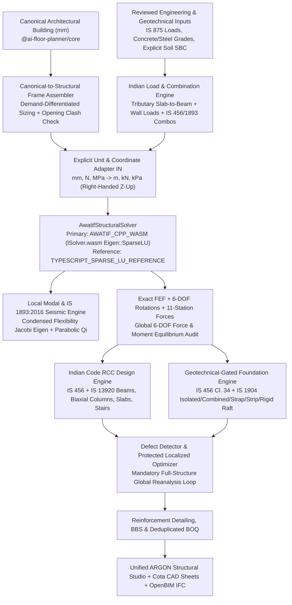

# Awatif Integration Architecture (`Phase A3`)

## 1. Unified Single-Application Architecture

RH Planner integrates Awatif as an internal headless computational package (`@ai-floor-planner/structural-engine`) inside the existing monorepo — **one application, one localhost runtime, one canonical `Building` model, and one unified ARGON Studio UI**.

## 2. Revision & Hash Binding Contract

Every structural analysis, RCC design, foundation design, optimization run, BBS schedule, and structural drawing package is cryptographically bound to:
- `projectId` & `buildingId`
- `sourceArchitecturalRevision` (`building.version`) & `sourceArchitecturalSha256` (`canonicalBuildingHash(building)`)
- `structuralModelRevision` & `engineeringInputsDigest`

Any architectural edit in AI Floor Plan, Cota CAD, or OpenBIM Studio increments `building.version`, immediately marking prior structural analysis results `STALE` until reanalyzed. Conversely, structural optimization modifies structural member sections/reinforcement/footings **without** altering protected architectural room polygons, wall positions, doors, windows, stairs, or lifts.

## 3. Execution Environments (Web Worker + Node Backend)

- **Browser / Web Worker:** `@ai-floor-planner/structural-engine` runs in a dedicated Worker or async task so large multi-combination solves and iterative global-reanalysis optimization never block the main UI thread.
- **Node.js Backend (`/api/v1/structural/*` & `/api/v1/export/*`):** Executes the exact same `lSolver.wasm` binary in Node.js for server-verified analysis, PDF engineering reports, Cota DXF/DWG structural sheets, OpenBIM IFC structural exports, and persistence.
